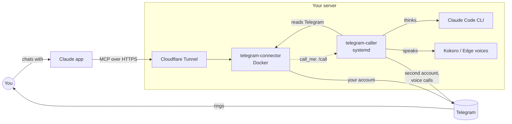

# Telegram for Claude

[](https://github.com/GR4Y-dev/telegram-for-claude/actions/workflows/tests.yml)
[](LICENSE)

Give Claude your Telegram, and give yourself an AI you can **phone**.

Two self-hosted pieces:

1. **Telegram connector.** An MCP server that lets Claude (claude.ai, the Claude apps, Claude
   Code) use Telegram **as your own account**: read, search and summarize chats, open photos and
   files, understand voice messages, look at profiles, and send, schedule, edit, forward or delete
   messages. Claude always shows you what it's about to do and waits for your "yes".
2. **Call assistant** (optional). A second Telegram account you can **call**, or that **calls you**
   ("call me at 7 and remind me about the exam"). It listens, thinks with Claude Code and talks
   back in **Persian or English**, optionally as **Jarvis**, a calm British AI butler.

Everything runs on your own server. Your Telegram login and keys never leave it.

## Features

**Connector (18 tools)**
- Read chats, also far back by date, and search across all of them (without marking them as read)
- Open attachments: photos and screenshots, PDFs (scanned ones too), Word, Excel, text and code files
- Write out voice messages, round videos and audio (Persian, English, Turkish and more)
- Profiles: bio, birthday, last seen, profile picture
- Send messages and files (from a link, written by Claude, or from another chat), now or **scheduled**
- Edit your own messages, forward, delete, mark as read
- `call_me` / `text_me`: your assistant rings you or texts you from its own account, now or later
- `update_server`: "update the server" updates everything right away
- Safety: confirmation before every change, 30 sends per hour, no profile, contact or group changes

**Call assistant**
- Answers your calls and calls you back; ignores everyone else
- Chats by text with a typing indicator and conversation memory; `/new` starts fresh
- Saves facts you explicitly ask it to remember, and sends one-time or repeating reminders
  with snooze and done commands, even when Claude's usage limit is reached
- Transcribes voice notes and replies in text; chats and calls know the current local and UTC time
- Turn-based talk: speech-to-text → Claude Code → speech, with a soft tick while it thinks
- Starts speaking Claude's first sentence while the rest is still being written
- Can search the web and read your Telegram during a call (never send)
- Voices: [Kokoro](https://github.com/thewh1teagle/kokoro-onnx) on your server for English,
  Microsoft's free neural voices for Persian
- Texts you too: reminders from Claude, update results, and anything a script on your server
  drops in its outbox

**Updates without logging in to the server**
- Every night the server updates itself, but only to versions whose tests passed on GitHub
- Send `/update` to your assistant (or ask Claude "update the server") to update right away
- The result comes as a text from your assistant

**Hear it:** Jarvis ([Lewis](docs/samples/jarvis-lewis.mp3), [George](docs/samples/jarvis-george.mp3),
[Daniel](docs/samples/jarvis-daniel.mp3), [Fable](docs/samples/jarvis-fable.mp3)) ·
Persian ([Dilara](docs/samples/persian-dilara.mp3), [Farid](docs/samples/persian-farid.mp3))

## How it works



- The **connector** logs in as your account with [Telethon](https://github.com/LonamiWebs/Telethon)
  and serves MCP tools on a secret HTTPS address through a free Cloudflare Tunnel (no open ports).
- The **call assistant** logs in as a second account and makes private Telegram calls with
  [py-tgcalls](https://github.com/pytgcalls/pytgcalls). Speech goes to OpenAI's speech-to-text,
  the text to `claude -p` (one Claude Code session per call, so it remembers the conversation),
  and the answer is spoken sentence by sentence.

---

## What you need

- **A Linux server** (Debian or Ubuntu) with root access, in a country where Telegram isn't
  blocked. 2 GB of memory is plenty (the Kokoro voice uses about 1 GB).
- **A domain on Cloudflare** (the free plan is fine).
- **Telegram API keys:** log in at **my.telegram.org** → API development tools → create an app,
  and keep the **api_id** and **api_hash**.
- **A Claude account** (claude.ai).
- **For calls only:** a **second Telegram account** (a spare number), **Claude Code** on the server,
  and an **OpenAI API key** for speech-to-text (about $0.006 per minute).

> **Never** paste your api_hash, login codes, tunnel token, OpenAI key or connector address into a
> chat with any AI. You type them only on your server and in claude.ai's settings.

---

## Part 1: the Telegram connector

### 1. Make a Cloudflare Tunnel (about 3 minutes)

1. **dash.cloudflare.com** → **Zero Trust** (pick the **Free** plan if asked).
2. **Networks → Tunnels → Create a tunnel** → **Cloudflared** → name it `telegram` → save.
3. Cloudflare shows install commands. **Copy only the long token** (the part after `--token`).
4. **Next** → **Public hostname**: subdomain `telegram`, your domain, type `HTTP`, URL
   `telegram:8000`. Save. Your connector will live at `telegram.<your domain>`.
5. **Important:** in your domain's dashboard, **Security → Bots** → turn **Bot Fight Mode off**.
   Otherwise Cloudflare blocks Claude and the connector "can't be reached".

### 2. Get the code onto the server

```bash
apt-get update && apt-get install -y git
git clone https://github.com/GR4Y-dev/telegram-for-claude.git /opt/telegram-for-claude
```

### 3. Run the setup

```bash
cd /opt/telegram-for-claude/telegram-connector && bash setup.sh
```

It installs Docker if needed, then asks one at a time for: the **tunnel token** (hidden), your
**time zone**, the **address** from step 1, your **api_id** and **api_hash**, your **phone
number**, the **code** Telegram sends to your app, and your two-step password if you have one.
At the end it prints your **connector address**, `https://telegram.<your domain>/<secret>/mcp`.
Treat it like a password.

### 4. Add it to Claude

claude.ai → **Settings → Connectors → Add custom connector** → name `Telegram`, URL: the address
from step 3. In a chat, check that Telegram is switched on (**+** → Connectors), then try
"send a test message to my Saved Messages".

---

## Part 2: the call assistant (optional)

### 1. Install Claude Code on the server and log in

```bash
curl -fsSL https://claude.ai/install.sh | bash
claude
```

Type `/login`, open the link, approve, paste the code back, then `/exit`.
Check it: `claude -p "say ok"`.

### 2. Run the setup

```bash
cd /opt/telegram-for-claude/telegram-caller && bash setup.sh
```

It asks for your **main** @username (the only account it will ever talk to), your first name,
your time zone, your **OpenAI key** (unless the connector already has one) and whether you want
**Jarvis**. Then it logs in the **second** account (the same api_id and api_hash work; use the
second account's phone number and code). When it says **All set!**:

- **call it** from your main account, or
- **send it** `/call` (or `call me`, `زنگ بزن`), or ask Claude "call me".

On a call: talk, pause for a second, wait through the ticks. Say "bye" / "خداحافظ" to end.

### 3. Let Claude see the new tools

claude.ai remembers a connector's list of tools. To pick up `call_me`, `text_me` and
`update_server`, remove the Telegram connector in **Settings → Connectors** and add it again with
the same address (print it again with `bash setup.sh` in `telegram-connector`).

---

## Updating

You don't need to log in to the server for updates:

- **Automatically:** the setup asks "Update automatically every night?". If you said yes, the
  server checks GitHub around 04:00 (server time) and installs a new version only if its tests
  passed. Turn it on or off later with `bash update.sh --install` / `bash update.sh --uninstall`.
- **Right now:** send `/update` to your assistant's account, or ask Claude "update the server".
- **Either way,** your assistant texts you the result: what changed, or why it didn't update.
- **If an update fails** (for example, the disk is full), it goes back to the version it had
  and tries again at the next update. Projects on the same server update one at a time.

By hand, on the server: `cd /opt/telegram-for-claude && bash update.sh` (or after a manual
`git pull`, `bash update.sh --now`). Your settings and logins are always kept.

## Messages from your assistant

Send these directly to your assistant's private Telegram chat:

| Message | What happens |
|---|---|
| `Remember that I prefer short answers` | Saves a fact for future chats and calls |
| `/memories` | Lists saved facts with their IDs |
| `/forget 1` | Removes fact #1 and starts a fresh chat |
| `Remind me in 20 minutes to take a break` | Saves a one-time reminder |
| `Remind me every weekday at 8am to study` | Repeats Monday through Friday in your configured time zone |
| `/reminders` (or `/tasks`) | Shows unfinished reminders |
| `/snooze 1 20` | Postpones reminder #1 by 20 minutes |
| `/done 1` | Finishes reminder #1 and stops any repeats |
| `/new` | Starts a fresh chat while keeping saved facts and reminders |

These commands work without Claude. The assistant service and Telegram connection must be
running to deliver reminders. Voice notes can use the same English commands, but still need
the speech-to-text service. Forwarded messages cannot create or change saved facts or reminders.
See [the reference](telegram-caller/README.md#saved-facts-and-reminders) for examples, limits,
restart behavior and backups. These new features are in the Telegram assistant; WhatsApp
keeps its existing scheduled-message feature.

- Ask Claude "text me tomorrow at 8: bring the passport" and your assistant's account texts you
  then (`text_me`). "Call me at 8" rings instead (`call_me`).
- Scripts on your server can text you too: anything written to a `.txt` file in
  `/var/spool/telegram-assistant/` is sent to you within a few seconds, then deleted.
  For example: `echo "Backup finished" > /var/spool/telegram-assistant/backup.txt`

## Troubleshooting

| Problem | Fix |
|---|---|
| Claude says the connector can't be reached | Turn **Bot Fight Mode off** in Cloudflare (Security → Bots) |
| Backspace types strange characters during setup | Ctrl+C, run `stty erase ^H`, start the setup again |
| A call is stuck on "exchanging encryption keys" | Update to the latest version (`git pull`, then `bash setup.sh`) |
| It answers but doesn't hear you | Check your mic isn't muted in the call screen |
| Voice messages aren't written out | Add an OpenAI key (see `telegram-connector/README.md`) or use Telegram Premium |
| New tools don't show up in Claude | Switch the Telegram connector off and on in the app |
| What happened on a call? | `journalctl -u telegram-caller -n 50 --no-pager` |

More commands and every setting: [`telegram-connector/README.md`](telegram-connector/README.md) and
[`telegram-caller/README.md`](telegram-caller/README.md).

## Security and privacy

The [security review](SECURITY-REVIEW.md) explains the fixes, checks and remaining limits.

- **Cut Claude off any time:** Telegram → Settings → Devices → end "Claude connector"
  (and "AI assistant" for the call account), or remove the connector in claude.ai.
- The connector address contains a long random secret; every other address returns "Not Found".
  If it leaks, make a new one (command in `telegram-connector/README.md`).
- Logins live only on your server (`data/`, `.env`, a Docker volume), readable only by root.
- The call assistant talks only to your main account and can't send anything during calls.
- **Disk space stays small.** Attachments are read in memory and never saved on the server.
  Saved call conversations are kept under `STORAGE_LIMIT_MB` (asked during setup, 1 GB by
  default, oldest deleted first), and Docker logs are capped at 30 MB per container.
- Telegram's rules: this logs in as normal user accounts. Personal use is fine; heavy automated
  messaging can get an account limited. There's a built-in limit of 30 sends per hour.

## Development

```bash
pip install -r telegram-connector/requirements.txt -r telegram-caller/requirements.txt
python tests/test_connector.py      # fake Telegram account, real file reading
python tests/test_caller.py         # needs ffmpeg; uses real Claude if `claude` is installed
python -m unittest discover -s tests -p 'test_chat.py'
python -m unittest discover -s tests -p 'test_assistant_*.py'
python -m unittest discover -s tests -p 'test_security.py'
```

## Credits

[Telethon](https://github.com/LonamiWebs/Telethon) ·
[py-tgcalls](https://github.com/pytgcalls/pytgcalls) ·
[MCP Python SDK](https://github.com/modelcontextprotocol/python-sdk) ·
[kokoro-onnx](https://github.com/thewh1teagle/kokoro-onnx) ·
[edge-tts](https://github.com/rany2/edge-tts) ·
[PyMuPDF](https://github.com/pymupdf/PyMuPDF) (AGPL) ·
[Cloudflare Tunnel](https://developers.cloudflare.com/cloudflare-one/connections/connect-networks/)

Not affiliated with Telegram, Anthropic or OpenAI. "Jarvis" is just a style name for the voice.

## License

[MIT](LICENSE)

## Call performance

Calls now load the English voice only when needed, release it after the call, reuse one
Claude process, and let you interrupt speech. Updates reuse unchanged container images
and preserve other applications' Docker resources. See [performance notes](PERFORMANCE.md)
and the [caller settings](telegram-caller/README.md) for tuning and remaining server checks.
